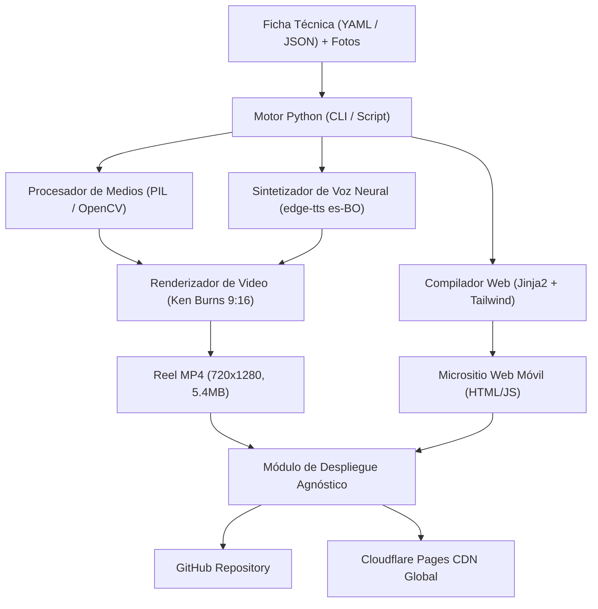

# Arquitectura del Sistema: Generador Automatizado de Micrositios y Reels Inmobiliarios

Este documento define la arquitectura técnica, las especificaciones del software autónomo ejecutable en Python, el análisis de estrategia de cuentas (Centralizada vs. Descentralizada) y el manual de credenciales de acceso para **GitHub** y **Cloudflare Pages**.

---

## 1. Visión General del Sistema

El objetivo es industrializar la creación de activos digitales de venta inmobiliaria de alta conversión, permitiendo procesar una propiedad en menos de 2 minutos mediante un único comando o interfaz:



---

## 2. Especificación del Software Autónomo en Python

El software se diseñará como un paquete modular (ej. `real_estate_engine/`) con un punto de entrada CLI.

### 2.1. Archivo de Entrada Estandarizado (`propiedad.yaml`)

```yaml
id: "urubo-bella-flor"
tipo_inmueble: "terreno"
titulo: "Terreno en Venta en Urbanización Bella Flor"
subtitulo: "Urubó • A 8 minutos del 4to Anillo"

metricas:
  superficie_m2: 704.74
  frente_m: 19.88
  topografia: "100% plano"
  documentacion: "Folio Real individual listo"
  precio_usd: 94400
  precio_m2_usd: 133.95

ubicacion:
  condominio: "Urbanización Privada Bella Flor"
  zona: "Urubó"
  ciudad: "Santa Cruz"
  pais: "Bolivia"
  tiempo_acceso_min: 8
  distancia_km: 4.2
  referencia_origen: "Puente Mario Foianini / 4to Anillo"

asesora:
  nombre: "Roxana Pozo"
  cargo: "Asesora Inmobiliaria Certificada"
  franquicia: "Century 21 Invictus"
  ubicacion_oficina: "Equipetrol, Santa Cruz"
  telefono_whatsapp: "59178535562"
  telefono_llamadas: "78535562"
  foto_archivo: "asesora.jpg"

branding:
  tema: "light" # light | dark
  color_fondo: "#FAF9F6"
  color_oro_primario: "#BEAF87"
  color_oro_oscuro: "#947D4E"
  color_texto: "#121212"

amenidades:
  - "Piscinas recreativas y solárium"
  - "Club House con churrasqueras equipadas"
  - "Canchas de tenis y fútbol con iluminación"
  - "Parque infantil y áreas verdes"
  - "Pórtico con seguridad y control 24/7"
```

### 2.2. Módulos Internos a Desarrollar

| Módulo | Archivo | Responsabilidad |
| :--- | :--- | :--- |
| **Ingesta & Validación** | `core/schema.py` | Valida con Pydantic la existencia de fotos, campos numéricos y teléfonos válidos. |
| **Procesador de Imágenes** | `media/image_processor.py` | - Recorta fotos del asesor/a a 1:1 cuadrado centrado en el rostro.<br>- Recorta asfalto roto o imperfecciones en el acceso.<br>- Genera la tarjeta Open Graph WhatsApp (1200x630). |
| **Locutor Neural** | `media/voice_synthesizer.py` | - Genera los 8 segmentos de audio con `es-BO-SofiaNeural`.<br>- Aplica reglas fonéticas estrictas (**"Céntury"**, conversión de números a palabras habladas).<br>- Concatena en una sola pista máster `.mp3`. |
| **Renderizador de Video** | `video/reel_renderer.py` | - Genera video 720×1280 a 30 FPS.<br>- Implementa barrido cinemático Ken Burns (pan-and-scan) ocupando toda la pantalla.<br>- Aplica tarjetas translúcidas de Modo Día y barra superior de progreso.<br>- Mezcla audio con `ffmpeg` habilitando `+faststart` (peso ~5 MB). |
| **Generador de Sitio Web** | `site/site_builder.py` | - Renderiza la plantilla Jinja2 (`index.html.jinja`) con Tailwind CSS.<br>- Inyecta enlaces directos de WhatsApp y llamadas telefónicas (`tel:`).<br>- Configura carrusel Swiper táctil. |
| **Desplegador Agnóstico** | `deploy/deployer.py` | - Ejecuta `git commit` y `git push`.<br>- Ejecuta `wrangler pages deploy` hacia Cloudflare Pages leyendo credenciales del entorno. |

---

## 3. Estrategia de Cuentas: ¿Centralizado o Descentralizado?

Uno de los puntos clave planteados es si conviene que **cada asesor tenga su propia cuenta de GitHub y Cloudflare** o si conviene **concentrarlo en una sola cuenta central**.

### Comparativa Estratégica

| Criterio | Opción A: Centralizado (1 Cuenta Agencia) | Opción B: Descentralizado (1 Cuenta por Asesor) |
| :--- | :--- | :--- |
| **Fricción Operativa para el Asesor** | **NULA**. El asesor solo envía fotos y ficha por WhatsApp/formulario. | **EXTREMA**. El asesor debe crear cuenta en GitHub, generar un PAT, crear cuenta en Cloudflare, generar un API Token y configurar DNS. |
| **Límites de Cloudflare Pages (Free)** | **Suficiente para cientos de inmuebles**.<br>• Ancho de banda: **Ilimitado y gratuito**.<br>• Hasta 100 proyectos simultáneos.<br>• Hasta 500 despliegues al mes. | Distribuye los 500 despliegues mensuales entre muchas cuentas gratuitas. |
| **Dominio y Marca** | **Uniforme y profesional**.<br>Ej: `propiedades.invictus.com/urubo-bella-flor/` o `admprop.pages.dev/urubo-bella-flor/`. | Disperso. Cada asesor tendría una URL diferente (ej: `juan-c21.pages.dev`, `maria-prop.pages.dev`). |
| **Control y Retención de Activos** | **Total**. Si un asesor deja la franquicia, la agencia conserva el micrositio, los leads y el dominio. | **Nulo**. Si el asesor se va, la propiedad queda huérfana en su cuenta personal. |
| **Seguridad de Credenciales** | Las llaves maestras residen en un único servidor/pipeline protegido. | Se deben distribuir y gestionar decenas de tokens personales con riesgo de fuga. |

### Conclusión y Recomendación: Arquitectura Híbrida Agnóstica

> [!IMPORTANT]
> **Recomendación**: Adopta el **Modelo Híbrido Agnóstico**:
> 1. **Por defecto (Operación Diaria)**: Todo se despliega a la **cuenta central de la agencia/administrador**. Los asesores no tocan tecnología ni llaves; solo venden.
> 2. **Por diseño (Agnóstico de Usuario)**: El software no tiene llaves "hardcodeadas". Si en el futuro un asesor VIP, una franquicia socia o un cliente particular desea su propia cuenta aislada, el software acepta un archivo `.env` o flags de configuración personalizadas:
>    ```bash
>    python run_pipeline.py --propiedad urubo.yaml --account-id <OTRO_ID> --api-token <OTRO_TOKEN>
>    ```

---

## 4. Guía y Procedimiento de Llaves de Acceso

Para operar el sistema de forma completamente agnóstica y segura, se utilizan dos capas de credenciales.

### 4.1. GitHub: Personal Access Token (PAT)

El token permite subir código y activos al repositorio Git sin requerir contraseñas interactivas.

#### Procedimiento para Generar el Token:
1. Iniciar sesión en GitHub y dirigirse a **Settings** -> **Developer Settings** -> **Personal access tokens** -> **Tokens (classic)**.
   - Enlace directo: `https://github.com/settings/tokens`
2. Hacer clic en **Generate new token (classic)**.
3. Asignar un nombre descriptivo: `Micrositios-Pipeline-Deployer`.
4. Seleccionar los permisos mínimos necesarios:
   - ✅ `repo` (Acceso completo a repositorios privados/públicos: clonar, commit, push).
5. Copiar el token generado (formato: `ghp_xxxxxxxxxxxxxxxxxxxxxxxxxxxx`).

#### Uso en el Script:
```bash
git push https://<GITHUB_PAT>@github.com/<USUARIO_O_ORG>/<NOMBRE_REPO>.git main
```

---

### 4.2. Cloudflare Pages: Account ID y API Token

Cloudflare Pages ofrece CDN global, certificados SSL automáticos y ancho de banda ilimitado con despliegues en el borde (edge).

#### 1. Obtener el `Account ID`:
1. Iniciar sesión en el panel de Cloudflare (`https://dash.cloudflare.com`).
2. En la barra lateral izquierda, hacer clic en **Workers & Pages**.
3. En la columna derecha de la pantalla, copiar el **Account ID** (cadena alfanumérica de 32 caracteres, ej: `f9c27e052ba062d6f9804fa5cf3cb023`).

#### 2. Generar el `API Token`:
1. Ir al perfil de usuario (esquina superior derecha) -> **My Profile** -> **API Tokens**.
   - Enlace directo: `https://dash.cloudflare.com/profile/api-tokens`
2. Hacer clic en **Create Token**.
3. Seleccionar la plantilla **Edit Cloudflare Workers** o crear un **Custom Token** con los siguientes permisos:
   - **Account** -> **Cloudflare Pages** -> **Edit**
4. En **Account Resources**, seleccionar: `Include -> All accounts` (o tu cuenta específica).
5. Hacer clic en **Continue to summary** y luego en **Create Token**.
6. Guardar el token (formato: `cfat_xxxxxxxxxxxxxxxxxxxxxxxxxxxx`).

#### Uso en el Script (Wrangler):
```powershell
$env:CLOUDFLARE_ACCOUNT_ID="f9c27e052ba062d6f9804fa5cf3cb023"
$env:CLOUDFLARE_API_TOKEN="cfat_xxxxxxxxxxxxxxxxxxxxxxxxxxxx"
npx wrangler pages deploy public --project-name admprop --branch main
```

---

### 4.3. Gestión Segura de Credenciales (`.env`)

Para que el software sea 100% agnóstico y seguro, las credenciales se almacenan en un archivo `.env` local (que **nunca** se sube a GitHub gracias a `.gitignore`):

```ini
# .env (archivo local confidencial - en .gitignore)
GITHUB_PAT=ghp_TU_TOKEN_PERSONAL_DE_GITHUB_AQUI
GITHUB_REPO_URL=https://github.com/rhalat1/admprop.git

CLOUDFLARE_ACCOUNT_ID=f9c27e052ba062d6f9804fa5cf3cb023
CLOUDFLARE_API_TOKEN=cfat_TU_TOKEN_DE_CLOUDFLARE_AQUI
CLOUDFLARE_PROJECT_NAME=admprop
```

---

## 5. Resumen de Archivos del Sistema Creados

1. **Skill de Antigravity**: [`.agents/skills/inmobiliaria-pipeline/SKILL.md`](file:///c:/Users/Administrador/Documents/rha/micrositios/.agents/skills/inmobiliaria-pipeline/SKILL.md)
2. **Generador Móvil de Video (Python)**: [`scripts/generate_instagram_reel_mobile.py`](file:///c:/Users/Administrador/Documents/rha/micrositios/scripts/generate_instagram_reel_mobile.py)
3. **Generador de Locución Neural (Python)**: [`scripts/generate_voiceover.py`](file:///c:/Users/Administrador/Documents/rha/micrositios/scripts/generate_voiceover.py)
4. **Ensamblador de Audio Máster**: [`scripts/prepare_audio.py`](file:///c:/Users/Administrador/Documents/rha/micrositios/scripts/prepare_audio.py)
5. **Micrositio de Producción**: [`public/urubo-bella-flor/index.html`](file:///c:/Users/Administrador/Documents/rha/micrositios/public/urubo-bella-flor/index.html)
