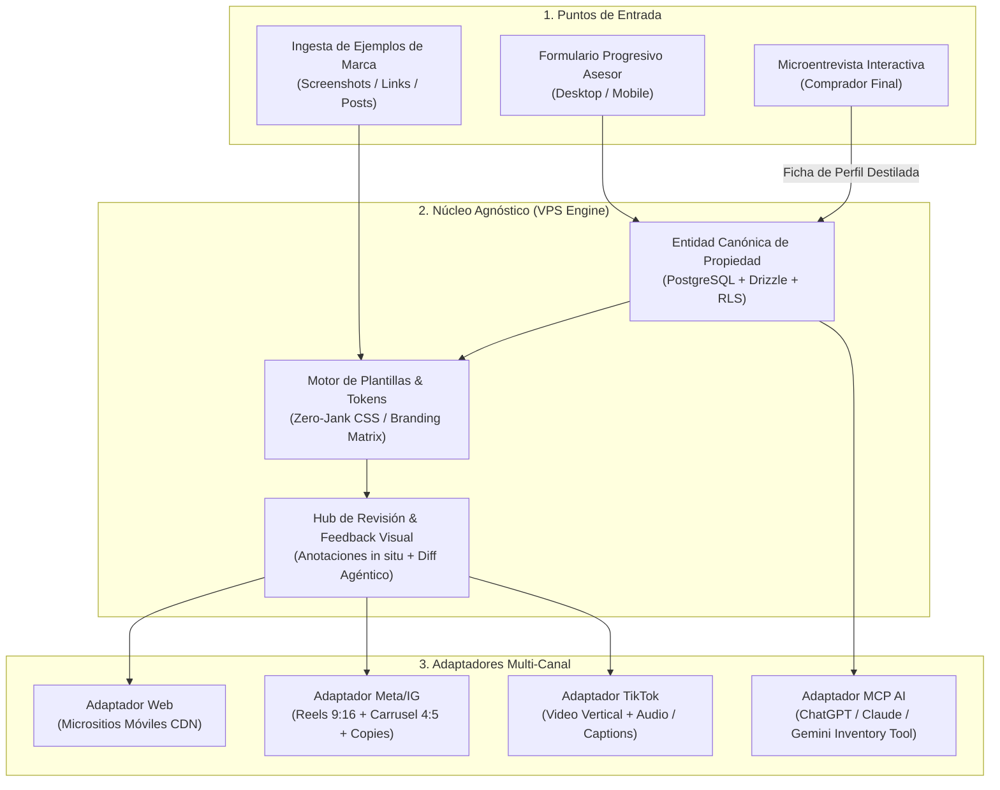
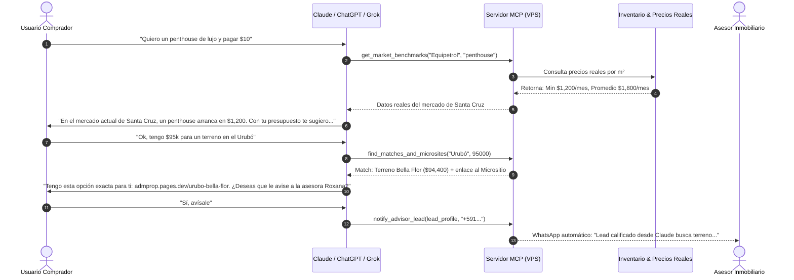

# Plan de Arquitectura e Implementación: Plataforma SaaS Inmobiliaria Agnóstica (RHA Real Estate Engine)

## Resumen Ejecutivo y Visión

Evolucionar el actual prototipo de micrositios estáticos hacia una **Plataforma SaaS Integral autoalojable en VPS** que desacopla la entidad canónica de la propiedad de sus canales de salida. 

El sistema permite a asesores inmobiliarios ingresar información una sola vez y alimentar:
1. **Micrositios Web de Alto Rendimiento** (Zero-Jank, Mobile-First, Cloudflare/VPS CDN).
2. **Activos para Redes Sociales** (Instagram Reels/Carruseles, TikTok 9:16).
3. **Servidor MCP para Asistentes de IA (ChatGPT, Claude, Gemini)** para responder consultas de compradores en lenguaje natural contra el inventario vivo.
4. **Motor de Plantillas con Ingesta de Estilo**: Creación de temas personalizados a partir de ejemplos previos del asesor.
5. **Capa de Revisión Visual con Feedback en Contexto**: Anotaciones directas sobre el diseño para iteración ágil antes de publicar.
6. **Microentrevista Interactiva de Calificación (Buyer Discovery)**: Embudo guiado que destila los deseos del cliente final y entrega al asesor un reporte cualificado.

---



---

## Decisiones de Arquitectura Confirmadas

> [!NOTE]
> **1. Despliegue en Modelo Híbrido (CONFIRMADO):**
> * **Backend & SaaS:** Alojado en el VPS del usuario (Fastify/Node.js, PostgreSQL con RLS, Drizzle ORM, colas BullMQ/Redis para procesamiento de video y servidor MCP).
> * **Entrega de Micrositios (Frontend Público):** Despliegue estático automático a **Cloudflare Pages / CDN**. Garantiza tiempos de carga sub-segundo en telefonía móvil y tolerancia absoluta a viralidad sin consumir CPU ni RAM del VPS.
> 
> **2. Almacenamiento Multimedia (CONFIRMADO):**
> * Se utilizará un bucket en **Cloudflare R2** (compatible con API S3, sin costes por transferencia de salida/egress) para alojar imágenes optimizadas en WebP y videos MP4 (tours, reels, animaciones de ruta).
> 
> **3. Protocolo de Integración con IA para Terceros (Claude, ChatGPT, Grok):**
> * Se implementará un servidor **MCP nativo** acompañado de una especificación OpenAPI/Swagger para permitir que agentes de terceros consulten benchmarks de precios reales del mercado, ejecuten discovery conversacional y deriven leads calificados directamente al WhatsApp de los asesores.

---

## Flujo de Descubrimiento con IA & Benchmarks de Mercado (MCP)



---

## Políticas y Consideraciones Operativas

> [!WARNING]
> **Políticas de Publicación Automática en Meta (Instagram/Facebook):**
> La publicación directa sin intervención humana requiere una cuenta Meta Business verificada y aprobación de App Review de Meta. Por ende, la **Fase 1** implementará el *"1-Click Ready Pack"* (descarga directa de assets y copia de textos con un clic), mientras que la **Fase 2** habilitará la integración OAuth con la API de Meta Graph / MCP.

---

## Proposed Changes

Implementaremos la solución en 4 fases secuenciales basadas en tu pipeline estándar de desarrollo (SDD):

```
micrositios/
├── .agents/                        # Marco de trabajo SDD y gobernanza
│   ├── rules/
│   │   ├── constitution.md         # Restricciones inmutables y 3 capas
│   │   └── ux_ui_zero_jank_standards.md
│   ├── agents/                     # Estratega, Arquitecto, Inquisidor, Implementador
│   └── workflows/
│       └── sdd-pipeline.md
├── PLAN_SAAS.md                    # Plan maestro de arquitectura SaaS y visión agnóstica
├── PRODUCT.md                      # Definición de producto SaaS y propuesta de valor
├── DESIGN.md                       # Especificación técnica, RLS y contratos
├── docker-compose.prod.yml         # Stack VPS (Postgres, Redis, Fastify/Next, Nginx)
├── contracts/                      # Contratos Zod agnósticos
│   ├── property.contract.ts        # Modelo canónico de la propiedad
│   ├── buyer-profile.contract.ts   # Resultado de la microentrevista interactiva
│   ├── visual-feedback.contract.ts # Eventos de corrección visual
│   └── template.contract.ts        # Tokens y estilos extraídos
├── server/                         # Backend en VPS (Fastify/Node TS)
│   ├── src/
│   │   ├── core/                   # Lógica determinística y base de datos (Drizzle)
│   │   ├── adapters/               # Adaptadores de canal
│   │   │   ├── web/                # Generador de micrositio móvil
│   │   │   ├── instagram/          # Renders Reel 9:16 y Carrusel 4:5
│   │   │   ├── tiktok/             # Video vertical
│   │   │   └── mcp/                # Servidor MCP para ChatGPT/Claude
│   │   └── workers/                # Colas BullMQ (FFmpeg, optimización WebP)
├── ui/                             # Panel del Asesor (Modo Operate)
│   ├── src/
│   │   ├── components/stepper/     # Formulario colapsable progresivo
│   │   ├── components/review/      # Canvas de revisión con feedback visual
│   │   └── components/quiz/        # Microentrevista interactiva para compradores
└── public/                         # Micrositios compilados (Modo Persuade)
```

---

### Componente 1: Núcleo de Datos Agnóstico (`contracts/property.contract.ts`)

Define el esquema maestro de una propiedad, completamente independiente de si se publica en Web, Instagram, TikTok o se consulta por IA.

```typescript
// Contrato canónico de Propiedad Inmobiliaria (Zod)
export const PropertyCanonicalSchema = z.object({
  id: z.string().uuid(),
  tenantId: z.string().uuid(), // ID del asesor/inmobiliaria
  slug: z.string().min(3),
  status: z.enum(['draft', 'active', 'reserved', 'sold']),
  
  // Datos Duros
  general: z.object({
    title: z.string().min(5),
    propertyType: z.enum(['terreno', 'casa', 'departamento', 'penthouse', 'comercial']),
    city: z.string().default('Santa Cruz de la Sierra'),
    zone: z.string(),
    addressOrCondo: z.string(),
    coordinates: z.object({ lat: z.number(), lng: z.number() }).optional(),
  }),
  
  // Financiero
  financial: z.object({
    currency: z.enum(['USD', 'BOB']).default('USD'),
    totalPrice: z.number().positive(),
    areaM2: z.number().positive(),
    pricePerM2: z.number().positive(), // Calculado determinísticamente
    financingAvailable: z.boolean().default(false),
  }),

  // Multimedia
  media: z.object({
    heroImage: z.string().url(),
    galleryImages: z.array(z.string().url()).min(3),
    routeVideoUrl: z.string().url().optional(),
    virtualTourUrl: z.string().url().optional(),
  }),

  // Asesor de Contacto
  advisor: z.object({
    name: z.string(),
    agency: z.string().default('Century 21 Invictus'),
    phoneWhatsApp: z.string(),
    photoUrl: z.string().url(),
    customGreeting: z.string(),
  }),
});
```

---

### Componente 2: Servidor MCP para Asistentes de IA (`server/src/adapters/mcp/`)

Permite a ChatGPT, Claude o agentes autónomos conectarse a tu inventario mediante el protocolo oficial MCP.

* **Herramienta `search_properties`**: Filtros por zona, rango de precio, tipo de propiedad y amenidades.
* **Herramienta `get_property_microsite`**: Devuelve la ficha completa y el enlace optimizado con WhatsApp preconfigurado para el comprador.
* **Herramienta `calculate_buyer_match`**: Compara las respuestas de la microentrevista de un cliente contra el catálogo activo.

---

### Componente 3: Motor de Ingesta y Plantillas Visuales

* **Extracción de Identidad Visual (Brand Ingestion)**:
  * El asesor sube 2 a 3 imágenes o capturas de sus publicaciones habituales.
  * El asistente analiza paleta cromática dominante, tipografía (serif vs sans), densidad de texto y estilo de tarjetas.
  * Genera un `theme.tokens.json` personalizado para ese asesor sin tocar código.
* **Librería Base de Componentes**:
  * *Theme Luxury Claro* (paleta Century 21: marfil, dorado/champagne, grafito).
  * *Theme Modern Dark* (para desarrollos vanguardistas / penthouse).
  * *Theme Minimalist Clean* (estilo nórdico / residencial familiar).

---

### Componente 4: Plataforma de Revisión y Feedback Visual en Contexto

* **Visual Review Canvas**:
  * Un visor interactivo que muestra la maqueta del micrositio y el mockup del post/Reel de Instagram en resolución móvil (375x812 pt).
  * **Click-to-Comment**: El asesor hace clic en cualquier texto, foto o contenedor e ingresa su indicación (*"Cambiar este texto a negrita"*, *"Quiero que la foto 2 vaya de primera"*, *"Agrandar el precio"*).
  * **Capa Agéntica de Refinamiento**: El feedback se traduce automáticamente en ajustes determinísticos sobre el modelo de datos o el CSS, permitiendo al asesor previsualizar y autorizar la versión final en segundos.

---

### Componente 5: Microentrevista Interactiva para Calificación de Compradores

Un flujo interactivo mobile-first ("¿Buscas la casa o terreno ideal pero no sabes por dónde empezar?") con preguntas estructuradas:

1. **Momento de Vida y Motivación**: ¿Inversión patrimonial, vivienda propia inmediata o construcción futura?
2. **Dinámica de Traslado**: ¿Dónde trabajas o estudian tus hijos? (Cálculo de tiempos: Urubó vs Zona Norte vs Equipetrol).
3. **Estilo y Amenidades Innegociables**: Seguridad 24/7, piscina, espacio para mascotas, canchas deportivas.
4. **Rango de Inversión y Financiamiento**: Contado, crédito bancario preaprobado o plan de pagos.
5. **Resultado Inmediato**: Genera una tarjeta de diagnóstico para el cliente y notifica instantáneamente al asesor por WhatsApp con el perfil exacto y las 2 o 3 opciones que hacen *match*.

---

## Verification Plan

### Pruebas Automatizadas
* **Validación de Esquemas Zod**:
  ```bash
  npx vitest run tests/contracts/
  ```
* **Compilación y Typecheck**:
  ```bash
  npx tsc --noEmit
  ```
* **Generación de Activos (Pipeline Headless)**:
  Ejecutar el test de renderizado de video y carrusel:
  ```bash
  npm run test:render-pipeline
  ```

### Verificación Manual del Asesor
1. Cargar una propiedad demo a través de la interfaz colapsable.
2. Comprobar que en menos de 60 segundos se generan:
   - El micrositio web con Swiper y botón WhatsApp funcional.
   - La previsualización del carrusel 4:5 y video Reel 9:16.
   - El enlace de consulta MCP respondiendo en tiempo real.
3. Probar la microentrevista en el móvil y constatar la recepción de la ficha de lead calificado en WhatsApp.
