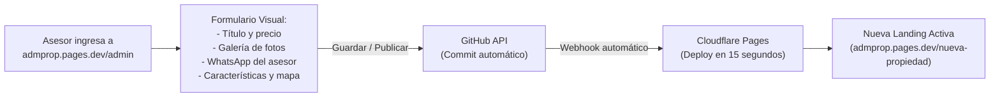

# Roadmap de Evolución: Micrositios Inmobiliarios

Este documento registra los próximos pasos y funcionalidades planificadas para el proyecto de micrositios en Cloudflare Pages y GitHub.

---

## 📌 Próxima Fase: Panel de Administración Visual (CMS) sin Código

### Objetivo
Permitir que asesores de ventas y administradores puedan crear, editar y publicar micrositios de propiedades inmobiliarias mediante un panel visual con formularios, sin necesidad de tocar código HTML ni Git.

### Arquitectura Planificada: Decap CMS / Cloudflare Pages

### Campos del Formulario Visual
1. **Datos Generales:**
   - Título del anuncio (ej. *Terreno en Venta Urubó - Urb. Bella Flor*)
   - Tipo de inmueble (Terreno / Casa / Departamento / Penthouse)
   - Ubicación (Zona, Condominio, Ciudad)
   - Estado (En Venta / En Alquiler / Reservado)
2. **Financiero:**
   - Precio total en USD
   - Superficie en m² (y cálculo automático de precio/m²)
   - Condiciones de pago / financiamiento
3. **Multimedia:**
   - Selector y cargador de imágenes (Hero, áreas sociales, planos)
   - Video (subida directa de MP4 o enlace de YouTube/Vimeo)
4. **Ficha Técnica & Amenidades:**
   - Medidas (frente, fondo, laterales)
   - Topografía y estado legal
   - Checklist de amenidades (piscinas, canchas, churrasqueras, seguridad)
5. **Contacto del Asesor:**
   - Nombre del asesor / inmobiliaria
   - Foto del asesor
   - Número de WhatsApp (con mensaje predeterminado)
   - Teléfono directo para llamadas

---

## 🚀 Historial de Hitos Completados (MVP)
- [x] Conexión y despliegue a **Cloudflare Pages** (`admprop.pages.dev`).
- [x] Repositorio de código conectado en **GitHub** (`rhalat1/admprop`).
- [x] Soporte de metadatos **Open Graph** para miniaturas enriquecidas en WhatsApp.
- [x] Micrositio 1: Servicio de Cohosting Airbnb.
- [x] Micrositio 2: Terreno Urubó Bella Flor con carrusel Swiper 100% táctil móvil, reproductor de video nativo, fotos aéreas de dron y ficha técnica estilo LoopNet.
